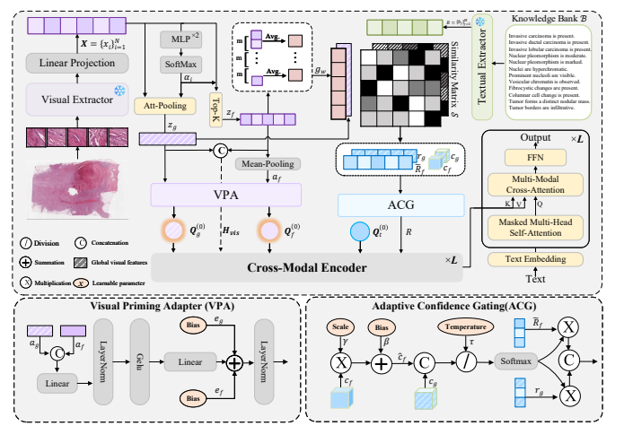

# Think Global, Look Focal: Dual-Stream Retrieval-Augmented Pathology Report Generation for Whole Slide Images [MICCAI 2026]

=====

<details>
<summary>
    <b>Think Global, Look Focal: Dual-Stream Retrieval-Augmented Pathology Report Generation for Whole Slide Images</b>.
    <a href="https://link.springer.com/chapter/10.1007/978-3-032-38062-3_55" target="blank">[Link]</a>
    <br><em>Liang Xiong*, Yi Zhang*, HaoJie Song, QianYao Peng, ShaoGuo Cui</em></br>
</summary>
</details>

**Summary:** We propose **DR-Gen**, a Dual-Stream Retrieval-Augmented Pathology Report Generation framework for gigapixel Whole Slide Images (WSIs). Inspired by the diagnostic workflow of pathologists, DR-Gen follows a "think global, look focal" paradigm. It decouples slide-level tissue architecture and focal cellular details through global and focal visual streams. A Visual Priming Adapter (VPA) uses the two visual streams as morphological anchors to guide report generation, while a CAP-protocol-guided diagnostic knowledge bank and an Adaptive Confidence Gating (ACG) module suppress non-diagnostic retrieval noise. Experiments on the PathText (BRCA) benchmark demonstrate state-of-the-art performance in both report generation and carcinoma subtype classification, including a 10.4% relative improvement in BLEU-4 over BiGen.



## Pre-requisites:

The Slide-Text captions are from **PathText**, which was collected by [**WsiCaption**](https://link.springer.com/chapter/10.1007/978-3-031-72083-3_51). The BRCA subset contains 1,041 aligned WSI-report pairs, including 845 training pairs, 98 validation pairs, and 98 testing pairs.

This repository provides the BRCA data splits, clinical attribute labels, and the encoded diagnostic knowledge bank `memory_short.pt`. The raw WSIs and pathology reports should be downloaded and preprocessed separately.

### Downloading TCGA Slides

To download diagnostic WSIs (formatted as `.svs` files), please refer to the [NIH Genomic Data Commons Data Portal](https://portal.gdc.cancer.gov/). WSIs can be downloaded using the [GDC Data Transfer Tool](https://docs.gdc.cancer.gov/Data_Transfer_Tool/Users_Guide/Data_Download_and_Upload/).

### Processing Whole Slide Images

To process WSIs, tissue regions are first segmented from downsampled slides. Non-overlapping `256 x 256` patches are then extracted from the tissue regions at `10x` magnification using [**CLAM**](https://github.com/mahmoodlab/CLAM). [**CONCH**](https://github.com/mahmoodlab/CONCH) is used to encode the raw image patches into 512-dimensional feature vectors, which are saved as a `.pt` file for each WSI.

## Running Experiments

Experiments can be run using the following generic command lines. This codebase is developed based on [**BiGen**](https://github.com/DeepMed-Lab-ECNU/BiGen).

### Training model

```shell
python main.py --mode 'Train' --n_gpu <GPUs to be used> --image_dir <CONCH FEATURE PATH> --ann_path <CAPTION PATH> --split_path <PATH TO TRAIN/VAL/TEST SPLIT CSV> --bank_path <KNOWLEDGE BANK PATH> --save_dir <SAVING CKPT PATH>
```

### Testing model

```shell
python main.py --mode 'Test' --n_gpu <GPUs to be used> --image_dir <CONCH FEATURE PATH> --ann_path <CAPTION PATH> --split_path <PATH TO TRAIN/VAL/TEST SPLIT CSV> --bank_path <KNOWLEDGE BANK PATH> --checkpoint_dir <PATH TO CKPT DIRECTORY> --save_dir <PATH TO SAVING RESULTS>
```


## Basic Environment

- Linux
- NVIDIA GPU (the experiments were conducted on an NVIDIA RTX 5000 Ada 32GB GPU)
- CUDA
- Python 3.10
